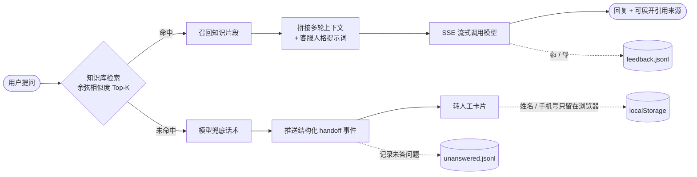

<div align="center">

# 🐦 云雀 AI 助理 · 智能聊天客服

**一个可以本地直接跑起来的智能客服 Web 应用**

[](https://nextjs.org/)
[](https://www.typescriptlang.org/)
[](https://tailwindcss.com/)
[](#如何替换成自己的知识库)
[](#如何切换模型厂商)
[](#目录结构)

[快速开始](#快速开始) · [四条核心路径](#四条核心路径) · [替换自己的知识库](#如何替换成自己的知识库) · [切换模型厂商](#如何切换模型厂商) · [目录结构](#目录结构) · [常见问题](#常见问题)

</div>

---

一个可以本地直接跑起来的智能客服 Web 应用：**Next.js 14 + TypeScript + Tailwind CSS**，
大模型走 **OpenAI 兼容接口**（默认 DeepSeek），带**本地知识库 RAG 检索**、**多轮上下文**、
**未命中自动转人工**和**未答问题收集**。不需要任何数据库和云服务，所有数据都落在本地文件里。

### 一次提问发生了什么



> 转人工卡片里的**姓名和手机号只写入浏览器 localStorage**，没有任何后端接口接收它们。

---

## 快速开始

```bash
# 1. 安装依赖（项目已配好国内镜像源，正常 1 分钟内装完）
npm install

# 2. 配置环境变量
cp .env.example .env.local
# 打开 .env.local，把 MODEL_PROVIDER 改成 deepseek，并填入 DEEPSEEK_API_KEY

# 3. 启动
npm run dev
```

访问 <http://localhost:3000>

> **不想先申请 API Key？** 项目默认是 `MODEL_PROVIDER=mock`，
> 不需要任何 Key 就能跑通「检索 → 流式输出 → 转人工」的完整链路，
> 只是模型回复是内置的假数据（页面顶部会有 `MOCK 模式` 角标提示）。
> 想接真实模型时，把 `MODEL_PROVIDER` 改成 `deepseek` 并填上 Key 即可。

### 自测

服务启动后，另开一个终端：

```bash
node scripts/selftest.mjs
```

会用真实 HTTP 请求跑完四条核心路径和两条边界情况，输出 12 项断言结果。

> ⚠️ **不要用 `curl` 测中文**。Windows 的 Git Bash 会把命令行里的中文按 GBK 编码发出去，
> 服务端按 UTF-8 解析就会变成乱码，导致明明该命中的问题被判成「未命中」。
> 自测脚本用的是 Node 原生 `fetch`，不存在这个问题。

---

## 环境变量

全部配置都在 `.env.local` 里（该文件已被 `.gitignore` 忽略，**永远不会被提交**）。
完整清单见 [.env.example](.env.example)，这里只列最常改的几个：

| 变量 | 默认值 | 说明 |
| --- | --- | --- |
| `MODEL_PROVIDER` | `mock` | `deepseek` / `openai` / `qwen` / `mock`，切换模型厂商 |
| `DEEPSEEK_API_KEY` | 空 | DeepSeek 的 Key，[在这里申请](https://platform.deepseek.com) |
| `MAX_CONTEXT_ROUNDS` | `10` | 服务端保留最近多少轮对话，超出自动截断 |
| `RAG_TOP_K` | `3` | 每次召回多少个知识片段 |
| `RAG_SCORE_THRESHOLD` | `0.15` | 余弦相似度低于该值判定为「未命中」，走转人工 |
| `CHUNK_SIZE` / `CHUNK_OVERLAP` | `300` / `50` | 知识切片大小与重叠字符数 |
| `EMBEDDING_PROVIDER` | `local` | `local`（零依赖本地向量）/ `openai`（真 embedding） |

---

## 四条核心路径

| 路径 | 触发方式 | 预期表现 |
| --- | --- | --- |
| **普通问答** | 输入「你好」 | 友好寒暄，不触发转人工 |
| **知识库命中** | 输入「标准版多少钱一年？」 | 检索到《价格方案》片段，回答里带出 2999 元/年，气泡下方可展开「引用了 N 条知识库内容」 |
| **多轮追问** | 接着问「那旗舰版呢？」 | 同一会话内继承上文，继续命中知识库 |
| **未命中转人工** | 输入「你们公司老板的手机号是多少？」 | 回答「这点我确认一下…」，并弹出转人工卡片（姓名 + 手机号 + 问题描述） |

---

## 如何替换成自己的知识库

1. 把产品手册、FAQ、价格表（`.md` 或 `.txt`）丢进 [knowledge/](knowledge/) 目录，支持子目录。
2. **不需要重启服务**，文件改动会被自动检测到并重建索引。

切片规则：先按 Markdown 标题（`#`/`##`/`###`）分成小节，每块都带上「标题路径」；
小节内再按空行分段，合并成约 `CHUNK_SIZE` 字的切片，相邻切片保留 `CHUNK_OVERLAP` 字重叠。
向量化时会把「文件名 + 标题路径」一起拼进去，所以用户问「标准版」时能匹配到标题里带「标准版」的切片。

### 调整命中阈值

换了自己的知识库后，建议先看看真实得分再决定阈值。开发环境提供了调参接口：

```bash
curl "http://localhost:3000/api/debug/retrieval?q=你的问题"
```

返回 Top-5 片段的相似度（忽略阈值），据此把 `RAG_SCORE_THRESHOLD` 调到
「真实问题都能过、无关问题都过不了」的分界线上。

本项目自带知识库（3 个文件 / 19 个切片）的实测分布，阈值取 **0.15**：

```
真实问题   0.164 ~ 0.420   ← 全部命中
无关问题   0.043 ~ 0.116   ← 全部未命中
```

> 该接口在 `NODE_ENV=production` 下会直接返回 404。

### 关于 Embedding

默认用的是**本地零依赖向量**（哈希 TF-IDF + 中文单字/双字切词 + 领域同义词扩展），
不需要任何 Key，离线可用。缺点是只有字面/近义层面的匹配能力，没有真正的语义泛化。

想换成真 embedding，改这两行即可（接口完全一致，上层检索逻辑不用动）：

```env
EMBEDDING_PROVIDER=openai
EMBEDDING_API_KEY=sk-xxxx
```

换成真 embedding 后，语义相近但用词完全不同的问法召回效果会明显变好，
但**阈值要重新调**（一般是 0.35~0.5，比本地向量的 0.15 高不少）。

---

## 如何切换模型厂商

改 `.env.local` 里的 `MODEL_PROVIDER` 就行，各厂商的配置互不干扰：

```env
# DeepSeek（默认推荐）
MODEL_PROVIDER=deepseek
DEEPSEEK_API_KEY=sk-xxxx
DEEPSEEK_MODEL=deepseek-chat

# OpenAI 或任意 OpenAI 兼容中转网关
MODEL_PROVIDER=openai
OPENAI_API_KEY=sk-xxxx
OPENAI_BASE_URL=https://api.openai.com/v1
OPENAI_MODEL=gpt-4o-mini

# 阿里云通义千问
MODEL_PROVIDER=qwen
DASHSCOPE_API_KEY=sk-xxxx
DASHSCOPE_MODEL=qwen-plus
```

三家走的都是 `/chat/completions` 这套 OpenAI 协议，所以底层只有一份实现
（见 [src/lib/llm.ts](src/lib/llm.ts)）。想接入别的兼容厂商，
只要在 [src/lib/config.ts](src/lib/config.ts) 的 `getModelConfig()` 里加一个分支即可。

---

## 目录结构

```
├── knowledge/                  知识库（放你自己的 md/txt）
│   ├── 产品介绍.md
│   ├── 价格方案.md
│   └── 退换货政策.md
├── data/                       运行期数据（已被 .gitignore 忽略）
│   ├── sessions/<id>.json      每个会话一个文件
│   ├── unanswered.jsonl        未命中的问题，用来补 FAQ
│   └── feedback.jsonl          用户 👍/👎 反馈
├── scripts/selftest.mjs        端到端自测脚本
└── src/
    ├── app/
    │   ├── page.tsx            首页
    │   ├── layout.tsx          根布局
    │   ├── globals.css         Tailwind + Markdown 排版
    │   └── api/
    │       ├── chat/           SSE 流式对话主接口
    │       ├── sessions/       会话列表 / 详情 / 清空 / 删除
    │       ├── feedback/       👍/👎 反馈
    │       ├── health/         服务状态（前端用来显示 MOCK 角标）
    │       └── debug/          检索调参接口（仅开发环境）
    ├── components/             UI 组件
    ├── hooks/useChat.ts        前端状态机：会话管理 + SSE 解析
    └── lib/
        ├── config.ts           所有环境变量的唯一出口
        ├── prompt.ts           客服人格 system prompt
        ├── moderation.ts       敏感词 / 合规领域 / 转人工意图识别
        ├── knowledge.ts        知识加载与切片
        ├── embeddings.ts       向量化（本地 / 远程）
        ├── retriever.ts        余弦检索 Top-K
        ├── context.ts          多轮上下文裁剪
        ├── llm.ts              多厂商流式调用
        ├── sessions.ts         会话持久化（带写锁）
        ├── analytics.ts        未答问题 + 反馈收集
        └── store.ts            文件读写工具
```

---

## 设计与实现要点

**API Key 安全**：Key 只从服务端 `process.env` 读取，所有模型调用都在
[src/app/api/chat/route.ts](src/app/api/chat/route.ts) 里完成，前端拿不到也用不到 Key。
`/api/health` 只返回一个 `keyConfigured` 布尔值，不泄露任何 Key 内容。

**客服人格**：写死在 [src/lib/prompt.ts](src/lib/prompt.ts)，不可被知识库内容覆盖。
核心约束是「只依据知识库片段回答，没有的信息一律说『这点我确认一下』」，
配合 `temperature=0.3` 把编造概率压到最低。

**转人工的三个触发点**：
1. 用户明确说「转人工 / 人工客服 / 真人」→ 服务端直接返回固定话术，不消耗模型额度
2. 检索未命中且不是寒暄 → 正常由模型回答兜底话术，回答结束后补发结构化 `handoff` 事件
3. 医疗 / 法律 / 投资类问题 → 在 system prompt 里追加约束，引导咨询专业人士

**多轮上下文**：按「轮」而不是按「条」裁剪（见 [src/lib/context.ts](src/lib/context.ts)），
保证发给模型的历史永远是完整的一问一答；裁剪后会丢掉开头孤立的 assistant 消息。

**写并发**：同一会话的读-改-写用 per-session 锁串行化（见 [src/lib/sessions.ts](src/lib/sessions.ts)），
避免「用户消息」和「助手回复」两次写入互相覆盖；文件写入采用「先写临时文件再 rename」的原子写。

**重试幂等**：发送失败后点「重试」，如果会话里最后一条已经是内容相同的用户消息，
服务端不会重复落盘。

**隐私**：转人工卡片里的姓名和手机号**只写入浏览器 localStorage**，没有任何后端接口接收它们。

---

## 常见问题

**Q：页面顶部显示「MOCK 模式」？**
说明当前 `MODEL_PROVIDER=mock`，回复是内置假数据。改成 `deepseek` 并填 Key，重启即可。

**Q：显示「未配置 Key」？**
`MODEL_PROVIDER` 已经是真实厂商，但对应的 Key 是空的。检查 `.env.local` 里
`DEEPSEEK_API_KEY`（或对应厂商的变量）是否填了，改完要重启 `npm run dev`。

**Q：答非所问，或者该命中的问题没命中？**
先用 `/api/debug/retrieval?q=...` 看实际得分。得分低通常是知识库里没有对应表述，
把用户常问的说法（口语）补进知识库，或在
[src/lib/embeddings.ts](src/lib/embeddings.ts) 的 `SYNONYM_GROUPS` 里加一组同义词。

**Q：改了 `knowledge/` 里的文件要重启吗？**
不用，索引会根据文件指纹自动重建。

**Q：中文全变成乱码 / 明明该命中的问题却未命中？**
大概率是你在用 Windows Git Bash 的 `curl` 发中文。用 `node scripts/selftest.mjs` 或
浏览器界面测试。

---

## 上线前还需要补的东西

这是一个功能完整的演示项目，但要真正上生产，下面几件事必须补：

- **内容安全**：`src/lib/moderation.ts` 里的敏感词表只是基础拦截，生产环境应换成专业内容安全服务
- **鉴权与限流**：目前接口完全开放，需要加登录态和按 IP / 会话的限流
- **会话存储**：文件存储在单机够用，多实例部署要换成数据库或对象存储
- **人工坐席后台**：`data/unanswered.jsonl` 和 `data/feedback.jsonl` 目前只能用脚本读，
  需要一个后台页面来查看和处理
- **可观测性**：补上调用耗时、检索命中率、转人工率等指标的埋点
